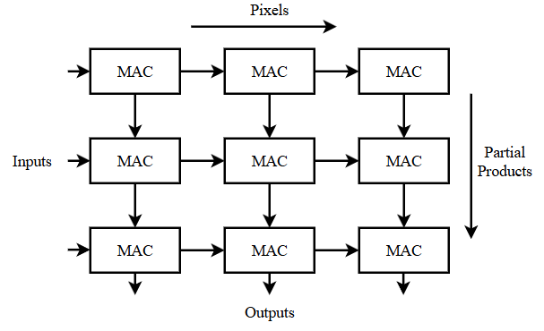
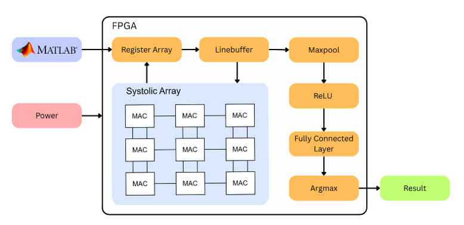
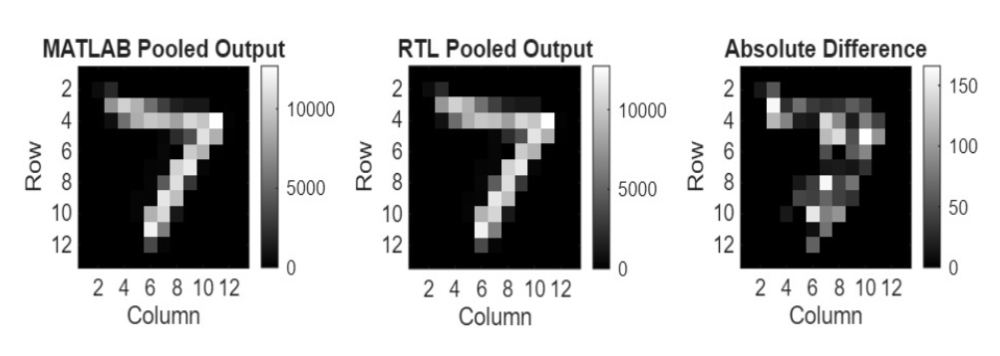

# Resource-Efficient CNN Accelerator on FPGA: A Custom Architecture for Digit Recognition

A hardware implementation of a custom, single-filter CNN for MNIST handwritten digit recognition, written in Verilog and verified against a MATLAB golden model. The design is fully fixed-point (INT8) and processes the image as a stream, from convolution through to the final predicted digit, entirely in hardware.

> **Problem statement:** Conventional CNNs incur high computational overhead and hardware resource usage due to repeated multiply-and-accumulate operations. This creates a need for efficient hardware implementations that balance computational performance, FPGA resource utilization, and classification accuracy.

---

## Table of Contents

1. [Overview](#overview)
2. [CNN Architecture](#cnn-architecture)
3. [Code Flow](#code-flow)
4. [Repository Structure](#repository-structure)
5. [Verification Against MATLAB](#verification-against-matlab)
6. [How to Run](#how-to-run)
7. [Results](#results)
8. [FPGA Deployment](#fpga-deployment)

---

## Overview

The network is a **custom architecture with a single convolution layer and a single filter**, followed by ReLU, max pooling and one fully connected layer. Keeping the model this compact keeps the hardware small: one 3x3 systolic array is reused across the whole image, so the design never needs to store full intermediate feature maps for the convolution stage.

Key features:

- **Custom CNN:** 1 convolution layer, 1 filter (3x3), ReLU, 2x2 max pooling, fully connected layer (169 inputs, 10 outputs), argmax.
- **Systolic-array convolution:** a 3x3 grid of 9 MAC units.
- **Vedic multiplier MACs:** each MAC uses a Vedic 8x8 multiplier built hierarchically (2x2 -> 4x4 -> 8x8). A conventional DSP-based MAC is also included for comparison and can be swapped in `systolic_3x3.v`.
- **INT8 fixed-point datapath** with 20-bit accumulators in the convolution stage and 32-bit scores in the FC stage.
- **MATLAB training and quantization flow:** weights and biases are exported as `.mem` files and loaded directly into the RTL with `$readmemb`.
- **Streaming dataflow:** row streamer, line buffers and a pipelined max-pool unit process pixels as they arrive.

---

## CNN Architecture

| Stage | Details |
|---|---|
| Input | 28 x 28 grayscale image (INT8, scaled 0-127) |
| Convolution | 1 filter, 3 x 3, stride 1, no padding -> 26 x 26 |
| Activation | ReLU |
| Pooling | 2 x 2 max pool, stride 2 -> 13 x 13 (169 features) |
| Fully connected | 169 -> 10 |
| Output | Argmax -> predicted digit (0-9) |

<!-- Add the CNN architecture image here -->
 

The convolution stage is implemented as a 3x3 systolic array of 9 MAC units:



### How the Systolic Array Works

- Each MAC unit holds one weight of the 3x3 kernel, so the kernel stays fixed while the image streams through.
- **Pixels move left to right:** every clock cycle, each MAC passes its input pixel to the MAC on its right.
- **Partial sums move top to bottom:** every clock cycle, each MAC adds its product (pixel x weight) to the partial sum from the MAC above and passes the result down.
- **Each row is delayed by one clock cycle:** row 0 enters immediately, row 1 one cycle later and row 2 two cycles later. This stagger keeps each partial sum aligned with the correct pixels, so the sums accumulate over the right 3x3 window and not over mixed columns.
- The bottom row of the array holds the finished sums, which are added together to give one convolution output per clock cycle once the pipeline is full.

---

## Code Flow

The design runs as a single pipeline controlled by `top_deploy.v`.

1. **Row streamer** (`linestreamer.v`, module `row_streamer`) generates addresses for three consecutive image rows.
2. **Image memory read:** the three rows are read from the image memory each cycle.
3. **Input stagger:** pixel rows are delayed so each array row sees its data at the correct cycle.
4. **Systolic convolution** (`systolic_3x3.v`) uses 9 MAC units. The outputs of the last array row are summed to produce one convolution result.
5. **ReLU** (`ReLU.v`) clips negative values to zero.
6. **Line buffer** (`linebuffers_2x2.v`) holds the previous row so a 2x2 window is available.
7. **Max pool** (`maxpool.v`) outputs the maximum of each 2x2 window.
8. **Feature memory** (`feature_mem.v`) stores the 169 pooled values.
9. **FC engine** (`fc_engine.v`) computes 10 class scores using a DSP-mapped multiply-accumulate and the stored weights and biases.
10. **Argmax** (`argmax.v`) selects the highest score and outputs the predicted digit.

<!-- Add the block diagram here -->
 

<!-- Add the flowchart here -->
 

---

## Repository Structure

```
.
├── assets/                  # Architecture images and output screenshots
├── constraints/
│   └── constraints_mmcm.xdc # PYNQ-Z2 pin and clock constraints
├── MATLAB/
│   ├── MNIST_training.m     # Train CNN, quantize, export weights (.mem)
│   ├── Output_verification.m# MATLAB golden model; writes matlab_pool_output.txt
│   ├── file_compare.m       # Compares RTL vs MATLAB pooled output, prints error metrics
│   ├── FC_mimic.m           # Runs the FC layer on the RTL pooled output
│   ├── mem_plotter.m        # Displays an image stored in a .mem file
│   ├── mnist.mat            # MNIST dataset used for training
│   └── mnist-matlab-master/ # MNIST conversion helper
├── mem/
│   ├── images/              # Test images in .mem format (dataset and hand-drawn)
│   └── weights/             # Convolution weights, FC weights, FC bias (.mem)
├── rtl/
│   ├── multipliers/         # Vedic 2x2, 4x4, 8x8, Vedic MAC, conventional MAC
│   ├── systolic_3x3.v       # 3x3 systolic array
│   ├── linestreamer.v       # Row streamer (address generator)
│   ├── linebuffers_2x2.v    # Line buffer for pooling
│   ├── maxpool.v
│   ├── ReLU.v
│   ├── feature_mem.v
│   ├── fc_engine.v
│   ├── argmax.v
│   ├── top_conv_only.v      # Convolution-only top module
│   ├── top_deploy.v         # Full CNN top module
│   └── top_mmcm.v           # Board wrapper with clock generation and input synchronizers
└── tb/                      # Testbenches for each module and the full design
```

---

## Verification Against MATLAB

Hardware output is verified against a MATLAB golden model that uses the same quantized image and weights.

1. The testbench in `tb/tb_top_deploy.v` simulates the full design and writes the RTL pooled output to **`pool_output.txt`** (169 values, one per pooled feature). It also writes `conv_output.txt` and `conv_debug.txt` for debugging.
2. `MATLAB/Output_verification.m` loads the same image and weights, runs the convolution, ReLU and pooling in MATLAB, and writes **`matlab_pool_output.txt`**.
3. `MATLAB/file_compare.m` compares `matlab_pool_output.txt` (golden) with `pool_output.txt` (RTL) and reports the match percentage, MAE, MSE and RMSE.
4. `MATLAB/FC_mimic.m` feeds the RTL pooled output through the trained FC layer to check the final scores and predicted digit.

<!-- Add the testbench output / verification plot image here -->


> **Note:** All files used by the MATLAB scripts (`pool_output.txt`, `matlab_pool_output.txt`, the image `.mem` file, `convolution_weights.mem`, `trained_net.mat`, `mnist.mat`) must be in the **same folder** as the MATLAB script you are running, **or** you must update the file paths at the top of each script. A wrong path causes errors such as `Cannot open file` or `File not found`.

---

## How to Run

### 1. Train and export weights (MATLAB)

1. Open `MATLAB/MNIST_training.m` with `mnist.mat` in the same folder.
2. Run the script. It trains the CNN, quantizes the weights to INT8 and exports `convolution_weights.mem`. It also saves `trained_net.mat`.

### 2. Simulate the RTL

1. Add all files from `rtl/` and `rtl/multipliers/`, and the testbench `tb/tb_top_deploy.v`, to your simulator (Vivado).
2. Add the memory (`.mem`) files as design sources in Vivado. The RTL loads them by name with `$readmemb`:
   - `convolution_weights.mem` (convolution weights)
   - `fc_weights.mem`
   - `fc_bias.mem`
   - the test image (for example `hand_drawn7.mem`)
3. Run the simulation. `pool_output.txt` is written to the simulation working directory.

> **Note:** The `.mem` files exported from MATLAB (weights, biases and test images) must also be accessible to Vivado. Add them to your project as **design sources** (Add Sources -> Add or Create Design Sources) so the simulator and synthesis can find them and load them through `$readmemb`. File names in `$readmemb` must match the names of the files you add exactly, otherwise the memories are not initialized and the output will be wrong.

### 3. Verify against MATLAB

1. Copy `pool_output.txt` into the `MATLAB/` folder.
2. Run `Output_verification.m` to generate `matlab_pool_output.txt`.
3. Run `file_compare.m` to see the match percentage and error metrics.

---

## Results

RTL pooled output compared against the MATLAB golden model:

| Metric | Value |
|---|---|
| Accuracy vs MATLAB golden model | 95.86% (162 / 169 pooled features match exactly) |
| Mean Absolute Error (MAE) | 0.086785 |
| Mean Squared Error (MSE) | 0.402367 |
| Root Mean Squared Error (RMSE) | 0.634324 |

The error values are measured on INT8 pooled feature values, so they are in units of one LSB.

---

## FPGA Deployment

The design is set up for the **PYNQ-Z2** board (125 MHz system clock):

- `top_mmcm.v` generates the fabric clock with an MMCM and synchronizes the reset and start inputs.
- `constraints/constraints_mmcm.xdc` contains the clock definition and pin assignments for the start and reset buttons and the output LEDs (predicted digit, `done`, `fc_done`).

---

## Author

**Rutuj Rotkar** | [GitHub](https://github.com/MrUnknownProg)
